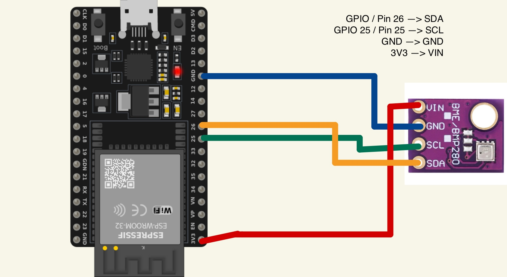

<h1>TempDash</h1>
With this project I built a webserver which shows the current temperatur,humidity and air pressure, as well as these messurements over the 10 last ours in a diagramm. all the data will be able to get downloaded via a button on the website.

For the Diagramm I used Chart.js

To set this up, you need a esp32 and a bme280 connected to pin 25 and 26
you will need to modify the python file to add your wifi ssid and password. Drag the html and python file to the esp32 and then create a file called data. Then go to the ip of your esp32 and enjoy :)

<h2>Wiring Diagramm</h2>

<h2>Preview in Browser</h2>

